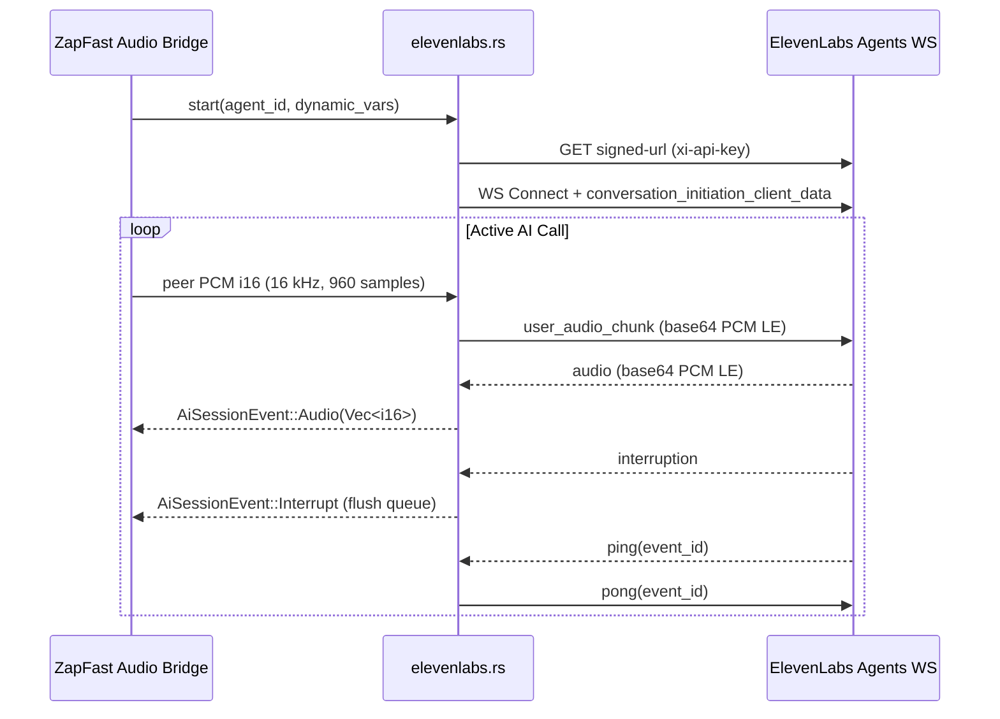

# Phase 2: ElevenLabs Conversational AI WebSocket Client

**Target:** Build a native Rust async client (`src/ai_call/elevenlabs.rs`) that streams 16 kHz mono PCM (Pulse-Code Modulation) audio bidirectionally with ElevenLabs Agents using existing workspace crates (`reqwest`, `tokio-websockets`, `base64`, `serde_json`).

## Technical Design
- **Audio Format Parity:** ZapFast's VoIP (Voice over Internet Protocol) engine (`src/call_audio.rs`) runs at 16,000 Hz mono `i16` (960 samples = 60 ms per frame), which matches ElevenLabs `pcm_16000` (16-bit signed little-endian PCM) directly with zero resampling.
- **Session Bootstrap:** Request a signed WebSocket URL from `GET https://api.elevenlabs.io/v1/convai/conversation/get-signed-url?agent_id=...` with header `xi-api-key`, then open the WebSocket with `tokio-websockets` and send `conversation_initiation_client_data` (including dynamic variables like `prospect_name`, `company`, and `meeting_link`).
- **Event Stream:** Emit typed internal events (`AiSessionEvent::Audio(Vec<i16>)`, `AiSessionEvent::Interrupt`, `AiSessionEvent::UserTranscript(String)`, `AiSessionEvent::AgentResponse(String)`, `AiSessionEvent::ToolCall { id, name, args }`, `AiSessionEvent::Disconnected(String)`).

- **Handshake Format Validation (Gap #3):** Parse `conversation_initiation_metadata_event` (`agent_output_audio_format`, `user_input_audio_format`). If the agent outputs `pcm_24000` or `pcm_44100` instead of `pcm_16000`, automatically resample to 16 kHz via `crate::call_audio::resample`; fail fast with a clear error on unsupported encodings (e.g. `ulaw_8000` without decoder).
- **Stale Audio Guard (Gap #4):** Track the latest `interruption` `event_id` and drop any inbound `audio` chunk whose `event_id <= last_interruption_event_id` so delayed network packets from an interrupted turn never play.

## Checklist
- [ ] **Signed URL & WS handshake (`src/ai_call/elevenlabs.rs`):** Fetch signed URL via `reqwest`, connect with `tokio-websockets`, and send `conversation_initiation_client_data` with dynamic variables.
- [ ] **Audio codec helpers:** Convert `&[i16]` <-> little-endian bytes <-> Base64 with zero unnecessary allocations and validate odd-byte edge cases.
- [ ] **Protocol event handling:** Parse `audio`, `interruption`, `ping` (auto-reply `pong`), `user_transcript`, `agent_response`, and `client_tool_call`; support sending `client_tool_result`.
- [ ] **Handshake metadata & resampling:** Parse `conversation_initiation_metadata_event`, validate `user_input_audio_format` / `agent_output_audio_format`, auto-resample non-16kHz PCM via `crate::call_audio::resample`, and fail cleanly on unsupported formats.
- [ ] **Stale audio filtering:** Track `last_interruption_event_id` and discard stale `audio` chunks with `event_id <= last_interruption_event_id`.
- [ ] **Clean teardown:** Ensure dropping or cancelling the session handle closes the WebSocket cleanly without orphaned Tokio tasks.
- [ ] **Unit tests:** Cover PCM <-> Base64 round-trips, JSON event deserialization, and `ping`/`pong` + `interruption` handling.
