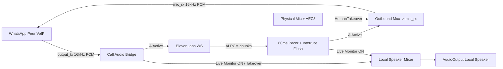

# Phase 3: Call Audio Bridge, Live Monitor & Instant Takeover

**Target:** Wire an AI-aware audio bridge into ZapFast's VoIP pipeline (`src/calls.rs` & `src/backend/worker/calls.rs`) so WhatsApp calls can be driven by ElevenLabs while letting the user listen live (Live Monitor) and switch seamlessly to their physical microphone at any moment (Takeover).

## Technical Design
- **Integration Point:** `client.voip().call(&peer).audio(mic_rx, output_tx)` in `src/calls.rs` takes stable `async_channel` endpoints (`Receiver<Vec<i16>>` and `Sender<Vec<i16>>`, 960 samples at 16 kHz). The bridge owns those channels so mode switching never drops or restarts the WhatsApp VoIP session.
- **Two Modes (`AiCallControlMode`):**
  - `AiActive`: Peer audio (`output_tx`) streams into ElevenLabs; AI playback buffer drains into `mic_rx` paced strictly every 60 ms (960 samples), outputting silence when idle and flushing immediately on `AiSessionEvent::Interrupt` (barge-in). Physical microphone is muted/not routed to prevent speaker feedback loops.
  - `HumanTakeover`: Immediately stops routing AI audio, closes/detaches the ElevenLabs WebSocket, routes physical `AudioInput` (with `FarEnd` echo cancellation intact) into `mic_rx`, and routes peer audio directly to `AudioOutput`.
- **Live Monitor (`AtomicBool`):** When enabled during `AiActive`, both peer audio and AI outbound audio are mixed (clamped `i16`) into the local `AudioOutput` speaker stream so the user hears both sides in real time. Toggling Live Monitor OFF silences the local speaker without interrupting the AI call.

## Checklist
- [ ] **Audio router & 60 ms pacer (`src/ai_call/bridge.rs`):** Implement `AiCallBridge` owning `mic_rx`/`output_tx`, 60 ms tick pacer (960-sample chunks), instant `Interrupt` buffer flush, and `i16` saturating mixer for Live Monitor.
- [ ] **Zero-drop Takeover state machine:** Implement atomic transition `AiActive -> HumanTakeover` that swaps `mic_rx` to `AudioInput`, updates `FarEnd` echo cancellation, and shuts down the ElevenLabs task cleanly.
- [ ] **Backend commands & events (`src/backend.rs`, `src/backend/worker/calls.rs`):** Add `Command::StartAiCall`, `Command::SetAiMonitor(bool)`, `Command::TakeoverAiCall`, and extend `CallUpdate` with `ai_state` (mode, monitor flag, AI speaking/listening status, latest transcript lines).
- [ ] **Audio lifecycle parity:** Start the ElevenLabs session only when the call reaches `CallPhase::Active` (media relay ready) so the AI never talks into ringback tone; tear down immediately on `CallPhase::Ended`.
- [ ] **Unit tests:** Verify 60 ms framing, interrupt flush drops queued AI frames immediately, Live Monitor mixing clamps cleanly without overflow, and Takeover switches source without closing `mic_rx`.
