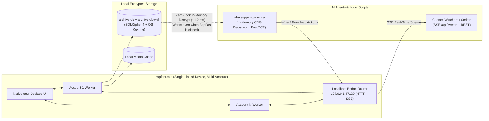

<p align="center">
  
</p>

<h1 align="center">ZapFast</h1>

<p align="center"><strong>WhatsApp, native and fast.</strong><br>A lightweight WhatsApp app for Linux, macOS, and Windows.</p>

<p align="center">
  <a href="https://zapfast.rocks/download/"><strong>Download</strong></a> ·
  <a href="https://zapfast.rocks/getting-started/">Getting started</a> ·
  <a href="https://zapfast.rocks/using-zapfast/">User guide</a> ·
  <a href="CONTRIBUTING.md">Contribute</a>
</p>

<p align="center">
  <a href="Cargo.toml"></a>
  <a href="https://zapfast.rocks/download/"></a>
  <a href="LICENSE"></a>
</p>

ZapFast is a WhatsApp client written in Rust with
[egui](https://www.egui.rs) and [fastframe](https://fastframe.dev), the
framework behind a family of native desktop apps. It links to your phone as a
companion device through
[whatsapp-rust](https://github.com/oxidezap/whatsapp-rust) and has no browser
engine. In our Linux test it opens in under a second and uses about 200 MB of
idle RAM, against 1.13 GB for WhatsApp Web.
[See the measurements](https://zapfast.rocks/benchmarks/).

The interface is available in English, Chinese (Simplified and Traditional),
Dutch, French, German, Indonesian, Italian, Portuguese (Brazil), Russian,
Spanish, and Turkish.

<picture>
  <source media="(prefers-color-scheme: light)" srcset="docs/screenshot-light.png">
  
</picture>

<details>
<summary><strong>Watch ZapFast in action</strong></summary>

https://github.com/user-attachments/assets/2bf86b54-45fc-4add-8de7-c426c3cdad9b

</details>

[Features](#your-chats-on-your-desktop) · [MCP & Localhost Bridge](#mcp--localhost-http--sse-bridge-fork-additions) · [Install](#install) · [Link your phone](#link-your-phone) · [Help](#guides-and-help)

## Your chats, on your desktop

| Feature | What you can do |
|---|---|
| **Messages** | Send formatted text, replies, edits, reactions, forwards, pictures, files, stickers, GIFs, polls, and voice messages. |
| **Media in the chat** | Play voice messages, videos, round video messages, GIFs, and animated stickers in place. |
| **Your history** | Keep your chats in an encrypted archive on this computer, fetch older messages from your phone as you scroll, and export locally saved chat history as text or a ZIP with downloaded attachments. |
| **Several numbers** | Link more than one WhatsApp number and switch between them in one window. |
| **Desktop controls** | Use keyboard shortcuts, select and copy text across messages, and stay linked in the tray with notifications. |
| **Themes** | Choose light, dark, system appearance, or custom colours. On Omarchy, follow your desktop theme. |
| **Privacy** | Hide locked chats behind a code, or the whole window behind an app lock. Nothing goes to a server of ours. |


## MCP & Localhost HTTP + SSE Bridge (Fork Additions)

This fork (`PramaAditya/zapfast`) embeds a zero-dependency **Localhost HTTP + Server-Sent Events (SSE) Bridge** on `127.0.0.1:47120` (`ZAPFAST_MCP_PORT` override supported) and pairs with `whatsapp-mcp-server` so AI agents (`omp`, Claude Desktop, Cursor) and local automation scripts share **one linked WhatsApp session** and **one encrypted SQLCipher database (`archive.db`)** with the desktop UI.



### Why Single-Device Integration?

| Capability | Legacy Standalone `whatsapp-bridge` (Go) | `PramaAditya/zapfast` MCP Bridge |
|---|---|---|
| **Linked WhatsApp Devices** | Requires a separate linked device (`whatsmeow`) | **1 shared linked device** with your desktop app |
| **Local Message Database** | Duplicate unencrypted `store/messages.db` | **Single SQLCipher 4 `archive.db` + `archive.db-wal`** |
| **Offline Read Access** | Fails if `bridge.exe` is not running | **Works even when ZapFast is closed** (in-memory AES-256-CBC decryption via Windows CNG + OS Keyring) |
| **Multi-Account Support** | Single account only | **Full multi-account routing** (`accounts.json` discovery, SHA-256 per-folder keyring lookup, `account` selector by ID, phone, or name) |
| **LID (`@lid`) & Contact Resolution** | Raw `@lid` JIDs often unresolved in groups | **Automatic `@lid` <-> `@s.whatsapp.net` & contact/push-name resolution** |
| **Sent Messages in Desktop UI** | Invisible in desktop client until resync | **Appears instantaneously** in ZapFast UI |
| **Auto-Update Safety** | N/A | **Auto-updater disabled** so custom binary is never overwritten |

### HTTP & SSE Endpoints (`http://127.0.0.1:47120`)

All endpoints accept an optional `"account"` selector (`"1"`, `"2"`, phone number `"628..."`, or account name) in the JSON body or `?account=` query parameter. When omitted, requests automatically target the active account in `accounts.json`.

| Method & Path | Description | Key Parameters / Filters |
|---|---|---|
| `GET /api/events` | **Real-time Server-Sent Events (SSE)** stream for incoming messages, edits, revokes, typing, presence, calls, and link status (0% overhead when idle) | `?chat=`, `?sender=`, `?types=incoming,typing,presence,call,message_updated,message_deleted,status`, `?archived=true\|false`, `?from_me=true\|false`, `?account=` |
| `GET /api/accounts` | List all linked WhatsApp accounts in ZapFast | Returns `account_id`, `active`, `connected`, `status`, `me_pn`, `me_name`, `archive_path` |
| `GET /api/status` | Active or selected account status + full `accounts` array | `?account=` |
| `POST /api/chats` | List chats with last message, archive/pin/mute/unread metadata | `query`, `limit`, `page`, `sort_by`, `archived` (`true`/`false`/`null`), `unread_only`, `chat_type` (`"direct"`/`"group"`), `account` |
| `POST /api/chat` | Get single chat metadata by JID or phone | `chat_jid`, `include_last_message`, `account` |
| `POST /api/direct-chat` | Find direct chat by phone number | `sender_phone_number`, `account` |
| `POST /api/contacts` | Search contacts and direct chats | `query`, `account` |
| `POST /api/contact-chats` | List all direct and group chats involving a contact | `jid`, `limit`, `page`, `account` |
| `POST /api/last-interaction` | Most recent message involving a contact | `jid`, `account` |
| `POST /api/messages` | Search and filter messages across chats | `after`, `before`, `sender_phone_number`, `chat_jid`, `query`, `limit`, `page`, `account` |
| `POST /api/message-context` | Fetch messages before and after a target message ID | `message_id`, `chat_jid`, `before`, `after`, `account` |
| `POST /api/group-info` | Fetch group metadata, description, admin flags, and resolved participants | `chat_jid`, `account` |
| `POST /api/query` | Execute a read-only `SELECT` / `WITH` / `PRAGMA` SQL query on `archive.db` | `sql`, `account` |
| `POST /api/send` | Send text, images, video, documents, view-once media, or Opus `.ogg` voice notes with **quote-reply** and **`@mentions`** | `recipient`, `message`, `media_path`, `is_voice`, `as_document`, `view_once`, `reply_to`, `mentions`, `account` |
| `POST /api/react` | React to a message with an emoji (or `""` to remove reaction) | `message_id`, `emoji`, `chat_jid` (optional), `account` |
| `POST /api/edit` | Edit a previously sent text message | `message_id`, `text`, `mentions` (optional), `chat_jid` (optional), `account` |
| `POST /api/revoke` | Revoke (delete for everyone) a sent message | `message_id`, `chat_jid` (optional), `account` |
| `POST /api/chat-action` | Trigger typing indicator or modify chat state | `chat_jid`, `action` (`typing`, `stop_typing`, `mark_read`, `mark_unread`, `archive`, `unarchive`, `pin`, `unpin`, `mute`, `unmute`), `mute_until`, `account` |
| `POST /api/fetch-older` | Request older chat history from the linked phone on demand | `chat_jid`, `account` |
| `POST /api/poll` | Create and send a native WhatsApp poll | `chat_jid`, `question`, `options`, `multiple`, `account` |
| `POST /api/download` | Return cached attachment path or download from WhatsApp (with phone media re-upload fallback) | `message_id`, `chat_jid` (optional), `account` |

### Quick Examples

```bash
# 1. Watch real-time incoming messages & typing events from a specific person or group (ignoring archived chats)
curl -N "http://127.0.0.1:47120/api/events?chat=Nana&types=incoming,typing&archived=false"

# 2. Send a quote-reply with @mentions
curl -X POST http://127.0.0.1:47120/api/send \
  -H "Content-Type: application/json" \
  -d '{"recipient":"6289675224270@s.whatsapp.net","message":"Siap!","reply_to":"3EB053C9C8DA63B4531F0D"}'

# 3. React to a message with an emoji
curl -X POST http://127.0.0.1:47120/api/react \
  -H "Content-Type: application/json" \
  -d '{"message_id":"3EB053C9C8DA63B4531F0D","emoji":"👍"}'
```
## Install

| Platform | Installation |
|---|---|
| **macOS** | `brew install --cask crmne/tap/zapfast`, or [download the Mac app](https://zapfast.rocks/download/#macos). |
| **Arch Linux** | `yay -S zapfast-bin` |
| **Windows** | Choose your build on the [Download page](https://zapfast.rocks/download/#windows). |
| **Other Linux** | Find Nix, AppImage, and other options on the [Download page](https://zapfast.rocks/download/#linux). |
| **From source** | Follow [Getting started](https://zapfast.rocks/getting-started/) for dependencies and commands. |

## Link your phone

1. Open ZapFast. It shows a QR code.
2. On your phone, open WhatsApp, then **Settings**, **Linked devices**,
   **Link a device**, and scan the code. Or click **Link with phone number**
   and enter the eight-character code on your phone.
3. Your recent chats arrive from the phone. Older messages follow as you
   scroll up.

The link survives restarts, and your phone does not need to stay online to
read what ZapFast has already stored. See
[Getting started](https://zapfast.rocks/getting-started/) for the full
walkthrough and [How it links](https://zapfast.rocks/how-it-links/) for the
details.

## Guides and help

The complete guide lives at **[zapfast.rocks](https://zapfast.rocks/)**.

| You want to… | Read |
|---|---|
| Know what ZapFast does and does not do yet | [What is ZapFast?](https://zapfast.rocks/what-is-zapfast/) |
| Link your phone or build from source | [Getting started](https://zapfast.rocks/getting-started/) |
| Learn messages, stickers, polls, and shortcuts | [Using ZapFast](https://zapfast.rocks/using-zapfast/) |
| Find settings, stored files, encryption, the app lock, and updates | [Settings and files](https://zapfast.rocks/settings-and-files/) |
| Make your own theme | [Making a theme](https://zapfast.rocks/themes/) |
| Understand what stays on this computer | [How it links](https://zapfast.rocks/how-it-links/) |
| Understand account risk | [Account safety](https://zapfast.rocks/what-is-zapfast/#account-safety) |
| Report a bug or propose a feature | Read [Contributing](CONTRIBUTING.md), then use the [issue forms](https://github.com/crmne/zapfast/issues/new/choose). |

## Contributing

Read [CONTRIBUTING.md](CONTRIBUTING.md) before opening an issue or pull
request. To look at the interface without a WhatsApp account, run:

```sh
cargo run --features demo -- --demo
```

[AGENTS.md](AGENTS.md) describes the architecture, [DEMO.md](DEMO.md) the
demo pages, screenshots, and recorded tours, and
[PACKAGING.md](PACKAGING.md) releases and packages.

Native notifications use Fastframe on Linux, macOS and Windows. ZapFast keeps
its account/chat routing, privacy settings, notification limits and sound
previews. Clicks open the announced message; reading a chat withdraws its
tracked notifications. OS permissions and notification presentation still apply.


## More native apps

**Want Spotify just as fast and native?** [Spotifast](https://spotifast.rocks)
is ZapFast's sibling. Both are built on
[fastframe](https://fastframe.dev).

## Acknowledgements

ZapFast uses [whatsapp-rust](https://github.com/oxidezap/whatsapp-rust),
[egui](https://www.egui.rs), [fastframe](https://fastframe.dev), the
[Inter](https://rsms.me/inter/) typeface and Noto Color Emoji (OFL), and
[Lucide](https://lucide.dev) icons (ISC), also used for the chat wallpaper
doodles. The notification sounds are [Pidgin](https://pidgin.im)'s, under the
GPL-2.0 (see `assets/sounds/`).

ZapFast is an unofficial client and is not affiliated with WhatsApp or Meta.
Using an unofficial client may be against WhatsApp's terms of service and
could get an account suspended. Use it at your own risk. WhatsApp is a
trademark of WhatsApp LLC.

Licensed under the [MIT License](LICENSE).

## Star history

<a href="https://www.star-history.com/?repos=crmne%2Fzapfast&amp;type=date">
  <picture>
    <source media="(prefers-color-scheme: dark)" srcset="https://api.star-history.com/chart?repos=crmne/zapfast&amp;type=date&amp;theme=dark">
    
  </picture>
</a>
