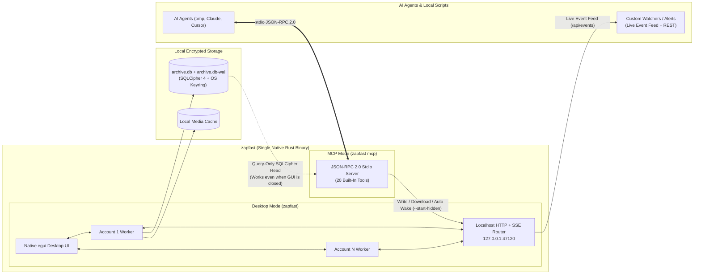

<p align="center">
  
</p>

<h1 align="center">ZapFast-MCP</h1>

<p align="center">
  <strong>Native Rust WhatsApp desktop client with a built-in MCP server and live local event feed in one binary.</strong>
  <br>
  A fork of <a href="https://github.com/crmne/zapfast">ZapFast</a> for AI agents and local workflows, sharing one linked device and one encrypted SQLCipher archive.
</p>

<p align="center">
  <a href="Cargo.toml"></a>
  <a href="#built-in-mcp-tools-20-tools"></a>
  <a href="#localhost-api--live-event-feed-12700147120"></a>
  <a href="#build-and-install"></a>
  <a href="LICENSE"></a>
</p>

> [!WARNING]
> **Upstream Policy Divergence & Account Risk Disclaimer**
>
> This fork **intentionally diverges** from the upstream [ZapFast](https://github.com/crmne/zapfast) project's principles, whose author explicitly prohibits AI integrations, MCP servers, bots, APIs, and any form of automation.
>
> - **Independent fork:** ZapFast-MCP is not affiliated with, endorsed by, or supported by the upstream ZapFast maintainer (`crmne`), WhatsApp, or Meta. Please do **not** open issues or pull requests regarding MCP or automation features on the upstream repository.
> - **Account risk:** WhatsApp's Terms of Service forbid automated and unofficial client usage and may lead to temporary or permanent account suspension. **Use at your own risk.**

<br>

<picture>
  <source media="(prefers-color-scheme: light)" srcset="docs/screenshot-light.png">
  
</picture>

<br>

---

## Quick Start

### 1. Connect your AI client (`zapfast mcp`)

Run the same `zapfast` binary with the `mcp` subcommand to start the native `stdio` JSON-RPC 2.0 MCP server. No Python, Node.js, or external bridge process is required.

**`omp` (`~/.omp/agent/mcp.json`)**
```json
{
  "mcpServers": {
    "zapfast-mcp": {
      "command": "C:/Users/<you>/AppData/Local/Programs/ZapFast/zapfast.exe",
      "args": ["mcp"],
      "enabled": true
    }
  }
}
```

**Claude Desktop / Cursor (`claude_desktop_config.json` / `mcp.json`)**
```json
{
  "mcpServers": {
    "zapfast-mcp": {
      "command": "C:\\Users\\<you>\\AppData\\Local\\Programs\\ZapFast\\zapfast.exe",
      "args": ["mcp"]
    }
  }
}
```

### 2. Link your WhatsApp account

1. Launch `zapfast` normally to open the desktop window.
2. On your phone, open **WhatsApp > Settings > Linked devices > Link a device** and scan the QR code (or link with phone number).
3. Your AI agent can now read chats, search messages, inspect groups, download media, and send messages through the shared companion session.

<br>

---

## Why One Native Binary?

| Capability | How ZapFast-MCP handles it |
|---|---|
| **Single binary (`zapfast` + `zapfast mcp`)** | Desktop UI (`egui`) and `stdio` JSON-RPC 2.0 MCP server compile into one Rust executable with zero extra runtime dependencies |
| **Offline & live reads (`< 1 ms`)** | Reads SQLCipher-encrypted `archive.db` + `archive.db-wal` directly in query-only mode via the OS keyring, even when the desktop window is closed |
| **Auto-wake for outgoing actions** | Calling a send, reaction, edit, revoke, or download tool while the app is closed automatically starts `zapfast --start-hidden` in the background |
| **Multi-account routing** | Discovers all accounts in `accounts.json`, unlocks each account's dedicated OS keyring entry, and accepts an optional `account` selector (ID, phone, or name) on every tool and endpoint |
| **Automatic `@lid` resolution** | Resolves WhatsApp privacy IDs (`@lid`) to canonical phone JIDs (`@s.whatsapp.net`) and contact/push names across direct and group chats |
| **Live notification & monitoring feed** | `GET /api/events` streams new messages, edits, revokes, typing, and calls in real time over a plain HTTP connection, ready to use as a skeleton for custom alerts, keyword watchers, or local dashboards (idle when nothing is listening) |
| **Safe from upstream overwrites** | Built-in auto-updater is disabled so upstream releases never silently replace your custom binary |

<br>

---

## Architecture



All fork additions are isolated in three dedicated modules (`src/mcp.rs`, `src/archive/mcp.rs`, and `src/backend/worker/mcp.rs`) with minimal single-line hooks in upstream files so syncing with [`crmne/zapfast`](https://github.com/crmne/zapfast) stays conflict-free.

<br>

---

## Built-In MCP Tools (20 Tools)

Every tool accepts an optional `account` parameter (`"1"`, `"2"`, phone number, or account name). When omitted, requests target the active account in `accounts.json`.

| Category | Tool | Description |
|---|---|---|
| **Accounts** | `list_accounts` | List all configured WhatsApp accounts (`account_id`, `phone_number`, `name`, `active`, `connected`, `archive_path`) |
| **Chats** | `list_chats` | List chats with state metadata (`is_archived`, `is_pinned`, `unread_count`, `is_muted`, `is_locked`, `kind`); filter by `query`, `archived`, `unread_only`, `chat_type` |
| **Chats** | `get_chat` | Get single chat metadata by JID or phone number |
| **Chats** | `get_direct_chat_by_contact` | Find a direct chat by phone number |
| **Chats** | `get_group_info` | Get group metadata, description, admin flags, and full participant list with resolved phone numbers and names |
| **Contacts** | `search_contacts` | Search contacts and direct chats by name or phone number |
| **Contacts** | `get_contact_chats` | List all direct and group chats involving a contact |
| **Contacts** | `get_last_interaction` | Get the most recent message involving a contact |
| **Messages** | `list_messages` | Search and filter messages (`after`, `before`, `sender_phone_number`, `chat_jid`, `query`, `include_context`) |
| **Messages** | `get_message_context` | Get surrounding messages before and after `message_id` |
| **Archive** | `query_archive` | Execute a read-only SQL query (`SELECT` / `WITH` / `PRAGMA`) against `archive.db` |
| **Send** | `send_message` | Send text to a contact or group, with optional `reply_to` (quote bubble) and `mentions` (`@mention` array) |
| **Send** | `send_file` | Send an image, video, audio file, or document (`caption`, `reply_to`, `as_document`, `view_once`) |
| **Send** | `send_audio_message` | Send an audio file as a WhatsApp voice note (`reply_to` supported) |
| **Send** | `send_poll` | Create and send a native WhatsApp poll (`chat_jid`, `question`, `options`, `multiple`) |
| **Actions** | `react_message` | React to a message with an emoji (or `""` to remove reaction) |
| **Actions** | `edit_message` | Edit a previously sent text message |
| **Actions** | `revoke_message` | Revoke (delete for everyone) a previously sent message |
| **Actions** | `chat_action` | Trigger `typing`, `stop_typing`, `mark_read`, `mark_unread`, `archive`, `unarchive`, `pin`, `unpin`, `mute`, or `unmute` |
| **Media** | `download_media` | Return cached attachment path or download media from WhatsApp (with phone re-upload fallback) |

<br>

---

## Localhost API & Live Event Feed (`127.0.0.1:47120`)

While the desktop app is running, ZapFast-MCP exposes a loopback-only HTTP API on `http://127.0.0.1:47120` (override port via `ZAPFAST_MCP_PORT`).

### Live Notification & Monitoring Skeleton (`GET /api/events`)

Instead of polling the database on a timer, any local script can stay connected to `GET /api/events` and receive live JSON events the instant something happens in WhatsApp (incoming message, edit, delete, typing indicator, presence change, or call). When nothing is listening, the feed does zero background work.

This makes it a ready-made skeleton for building your own lightweight monitors, such as:
- **Custom notification rules:** alert only for specific VIP contacts, groups, or keywords while ignoring archived or muted chats.
- **Local triggers & workflows:** kick off a desktop notification, webhook, log entry, or AI triage script when an important message arrives.
- **Live dashboards:** display active conversations or typing indicators in a status bar or personal dashboard.

**Quick test in your terminal (`curl`):**
```bash
# Watch live messages and typing events for a specific chat, ignoring archived chats
curl -N "http://127.0.0.1:47120/api/events?chat=Project&types=incoming,typing&archived=false"
```

**Minimal watcher skeleton (Python):**
```python
import json, requests

url = "http://127.0.0.1:47120/api/events?types=incoming&archived=false&from_me=false"
with requests.get(url, stream=True, timeout=(5, None)) as feed:
    for line in feed.iter_lines(chunk_size=1, decode_unicode=True):
        if line and line.startswith("data: "):
            event = json.loads(line[6:])
            print(f"[{event['chat_name']}] {event['sender_name']}: {event['text']}")
            # Add your own custom alert, keyword check, or local trigger here
```

### Other REST Examples

```bash
# Send a quote-reply with @mentions
curl -X POST http://127.0.0.1:47120/api/send \
  -H "Content-Type: application/json" \
  -d '{"recipient":"6281234567890@s.whatsapp.net","message":"On it!","reply_to":"3EB053C9C8DA63B4531F0D"}'

# Run a read-only SQL query on the encrypted local archive
curl -X POST http://127.0.0.1:47120/api/query \
  -H "Content-Type: application/json" \
  -d '{"sql":"SELECT count(*) AS total_chats, sum(archived) AS archived_chats FROM chats"}'
```

<details>
<summary><strong>Full HTTP + SSE Endpoint Reference (21 endpoints)</strong></summary>

| Method & Path | Description | Key Parameters / Filters |
|---|---|---|
| `GET /api/events` | Real-time Server-Sent Events (SSE) stream | `?chat=`, `?sender=`, `?types=incoming,typing,presence,call,message_updated,message_deleted,status`, `?archived=true\|false`, `?from_me=true\|false`, `?account=` |
| `GET /api/accounts` | List all linked accounts | Returns `account_id`, `active`, `connected`, `status`, `me_pn`, `me_name`, `archive_path` |
| `GET /api/status` | Active or selected account status + `accounts` array | `?account=` |
| `POST /api/chats` | List chats with state metadata | `query`, `limit`, `page`, `sort_by`, `archived`, `unread_only`, `chat_type`, `account` |
| `POST /api/chat` | Get single chat by JID or phone | `chat_jid`, `include_last_message`, `account` |
| `POST /api/direct-chat` | Find direct chat by phone number | `sender_phone_number`, `account` |
| `POST /api/contacts` | Search contacts and direct chats | `query`, `account` |
| `POST /api/contact-chats` | List all chats involving a contact | `jid`, `limit`, `page`, `account` |
| `POST /api/last-interaction` | Most recent message involving a contact | `jid`, `account` |
| `POST /api/messages` | Search and filter messages | `after`, `before`, `sender_phone_number`, `chat_jid`, `query`, `limit`, `page`, `account` |
| `POST /api/message-context` | Fetch messages before and after a message ID | `message_id`, `chat_jid`, `before`, `after`, `account` |
| `POST /api/group-info` | Fetch group metadata and resolved participants | `chat_jid`, `account` |
| `POST /api/query` | Execute a read-only SQL query on `archive.db` | `sql`, `account` |
| `POST /api/send` | Send text, media, document, view-once, or voice note | `recipient`, `message`, `media_path`, `is_voice`, `as_document`, `view_once`, `reply_to`, `mentions`, `account` |
| `POST /api/react` | React to a message with an emoji | `message_id`, `emoji`, `chat_jid`, `account` |
| `POST /api/edit` | Edit a previously sent text message | `message_id`, `text`, `mentions`, `chat_jid`, `account` |
| `POST /api/revoke` | Revoke a sent message for everyone | `message_id`, `chat_jid`, `account` |
| `POST /api/chat-action` | Typing indicator or chat state mutation | `chat_jid`, `action`, `mute_until`, `account` |
| `POST /api/fetch-older` | Request older chat history from phone | `chat_jid`, `account` |
| `POST /api/poll` | Create and send a native poll | `chat_jid`, `question`, `options`, `multiple`, `account` |
| `POST /api/download` | Return cached attachment path or download media | `message_id`, `chat_jid`, `account` |

</details>

<br>

---

## Build and Install

- **Windows CI artifact:** Every push to `main` builds `zapfast.exe` (`x86_64-pc-windows-msvc`) via [GitHub Actions](.github/workflows/build-windows.yml). Download the `zapfast-windows-x64` artifact and place it in your preferred install path.
- **From source (Windows, macOS, Linux):**
  ```bash
  cargo build --locked --release --bin zapfast
  ```
  See the upstream [Getting started guide](https://zapfast.rocks/getting-started/) for OS-specific build libraries.

<br>

---

## Credits

Built on top of [ZapFast](https://github.com/crmne/zapfast) by `crmne`, powered by [whatsapp-rust](https://github.com/oxidezap/whatsapp-rust), [egui](https://www.egui.rs), and [fastframe](https://fastframe.dev).

<p align="center">
  <sub>Licensed under the <a href="LICENSE">MIT License</a> · Unofficial fork, not affiliated with ZapFast upstream, WhatsApp, or Meta.</sub>
</p>
